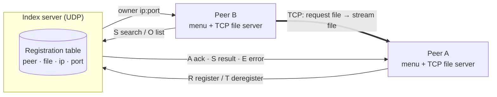

# Distributed File Sharing System

A peer-to-peer file sharing system in C: a lightweight index server keeps track of which peer has which file, and peers download files directly from each other.

## Tech Stack

C · POSIX sockets (UDP + TCP) · pthreads · Make

## Features

- **Register** files you want to share with the index server.
- **Search** for a file by name and get back the peer that has it.
- **List** everything currently shared across the network.
- **Download** a file straight from the peer that owns it over TCP.
- **Deregister** automatically on quit, so the index stays accurate.
- **Concurrent peers**: each peer serves files in a background thread while its menu stays responsive.

## Architecture



The index server only stores metadata; file contents never pass through it. Each peer runs two things at once: a text menu that talks to the index over UDP, and a TCP file server thread that sends files to other peers.

**Message format:** every UDP message is a fixed-size PDU: one type character plus a 100-byte text field.

| Type | Direction | Meaning |
|---|---|---|
| `R` | peer → index | register `peer file ip port` |
| `S` | both | search by file name / reply with `ip peer port` |
| `O` | both | list request / reply with all registrations |
| `T` | peer → index | deregister a peer |
| `A` | index → peer | acknowledgement |
| `E` | index → peer | error (not found, table full) |

## Getting Started

**Prerequisites:** Linux, macOS, or WSL with `gcc` and `make` (verified with gcc 13 on Ubuntu under WSL).

```bash
make                              # builds ./index and ./peer

./index 9000                      # terminal 1: index server on UDP port 9000
./peer 127.0.0.1 9000 9001        # terminal 2: peer A (index ip, index port, own TCP port)
./peer 127.0.0.1 9000 9002        # terminal 3: peer B
```

Then use the menu: in peer A choose **1 Register** for a file in its folder; in peer B choose **2 Search**, then **3 Download** with the IP and port it returns.

## Technical Decisions & Challenges

- **UDP for control, TCP for data.** Short index requests fit in one datagram, while file transfers need TCP's reliable, ordered delivery.
- **Index stores locations, not files.** Peers transfer directly, so the server stays tiny and isn't a bandwidth bottleneck.
- **Threaded file server.** A pthread lets a peer upload to others while its user is searching or downloading.
- **Defensive transfers.** The file server only serves names without paths (no `/` or `..`), and a missing file returns an error that the downloader reports instead of saving.

## Limitations

- Peers advertise `127.0.0.1`, so the system currently runs on one machine.
- The file server handles one download at a time, and the list reply is limited to one 100-byte message.
- The index table lives in memory and is lost when the server stops.

## Next Steps

- Let peers advertise a real network address so it works across multiple machines.
- Serve each download in its own thread for parallel transfers.
- Split long list replies across several messages.
- Add timeouts and retries for UDP requests in case a datagram is lost.

## Credits

Built as a team project (2 members).

## License

[MIT](LICENSE)
